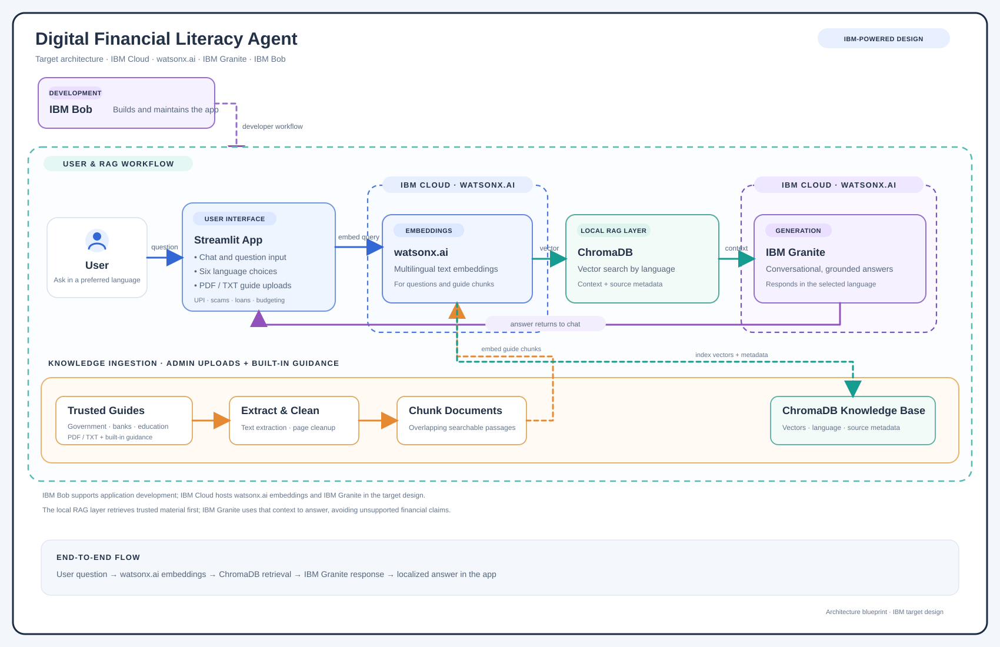

# Digital Financial Literacy Agent

A multilingual retrieval-augmented assistant for practical financial education. Ask questions about UPI, online scams, budgeting, loan interest, digital payments, and government schemes in English, Hindi, Tamil, Telugu, Bengali, or Marathi.

## Features

- Streamlit chat interface with localized example prompts.
- Retrieval from a persistent local ChromaDB knowledge base.
- Built-in guidance in six supported languages.
- Upload PDF and TXT guides through the Resources & documents panel.
- PDF page-reference cleanup and source-grounded answers.
- Optional IBM watsonx.ai / IBM Granite answer generation when IBM credentials are configured.

## Architecture

The current app uses a multilingual sentence-transformer model to create embeddings and ChromaDB for vector search. If relevant material is found, the app can pass that retrieved context to IBM Granite through IBM watsonx.ai to generate a conversational answer. Without IBM credentials, it returns a formatted answer from the retrieved material.

IBM Bob is a development assistant and is not part of the running request path. The diagram shows the target IBM architecture; IBM Cloud / watsonx.ai features require a configured IBM project and credentials.



## Requirements

- Python 3.10 or later
- Network access on first run to download the local embedding model
- IBM Cloud API key and watsonx.ai project ID only if enabling IBM Granite generation

## Setup

From the project directory, create and activate a virtual environment, then install dependencies:

```powershell
python -m venv .venv
.\.venv\Scripts\Activate.ps1
python -m pip install -r requirements.txt
```

Optional: copy `.env.example` to `.env` and set your IBM credentials:

```dotenv
WATSONX_APIKEY=your_ibm_cloud_api_key
WATSONX_PROJECT_ID=your_watsonx_project_id
WATSONX_URL=https://us-south.ml.cloud.ibm.com
WATSONX_MODEL_ID=ibm/granite-3-8b-instruct
```

When these values are not configured, the application uses retrieval-based answers without IBM Granite generation.

## Run

```powershell
python -m streamlit run app.py
```

Open the local URL printed by Streamlit, usually `http://localhost:8501`.

## Add documents

In the app, expand **Resources & documents**, upload PDF or TXT guides, and choose **Add to knowledge base**. The app extracts text, chunks it, creates embeddings, and adds it to the local ChromaDB index. Uploaded guides and the local vector index are excluded from Git; add your own documents after setup.

## Tests

```powershell
python -m unittest -v
```

## Main files

- `app.py` — Streamlit interface and document upload flow.
- `rag_engine.py` — document processing, multilingual embeddings, ChromaDB retrieval, and optional IBM Granite generation.
- `test_rag_engine.py` — retrieval, language coverage, chunking, and answer cleanup tests.
- `architecture_blueprint.svg` — architecture diagram.
- `financial_docs/` — PDF/TXT documents available for ingestion.
